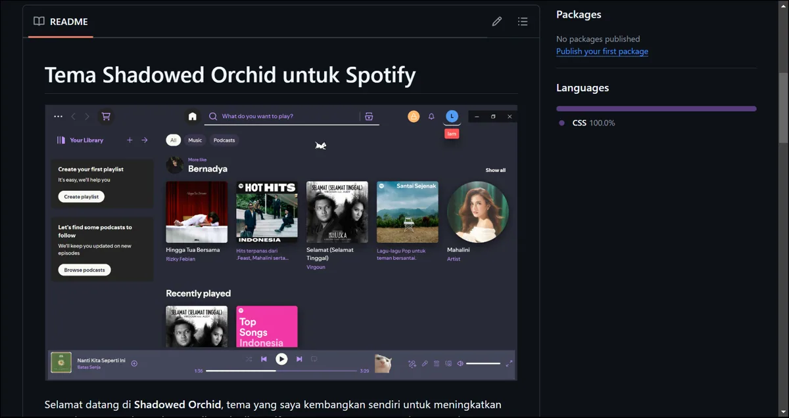

# 3D Cyberpunk Universe

**Arsip studi kasus · Portofolio Lamberth Paulinus Rumpaidus**

## Ringkasan

Eksperimen ruang tiga dimensi dengan transisi kamera, objek prosedural, dan atmosfer visual futuristik.

## Tantangan

Menghadirkan pengalaman visual 3D yang menarik tanpa mengorbankan kemudahan navigasi.

## Pendekatan

Memanfaatkan Three.js dan WebGL untuk menyusun geometri, sistem kamera, pencahayaan, serta animasi antarsudut pandang.

## Hasil

Eksplorasi dunia digital 3D yang merespons interaksi pengguna di dalam browser.

## Refleksi pengembangan

Eksperimen ini membantu memahami optimasi render dan cara membuat antarmuka 3D tetap ramah perangkat berbeda.

## Teknologi

- Three.js
- WebGL
- GSAP
- JavaScript

## Status publikasi

Halaman ini merupakan arsip dokumentasi berdasarkan katalog portofolio dan aset visual yang tersedia. Kode sumber asli proyek belum tersedia dalam repositori publik yang terverifikasi. Arsip ini tidak menyatakan bahwa aplikasi dapat dijalankan dari repositori tersebut.

[Portofolio](https://lamberthrumpaidusprofile.netlify.app/) · [Dokumentasi proyek](https://lamberthrumpaidusprofile.netlify.app/documentation.html?project=cyberpunk)
