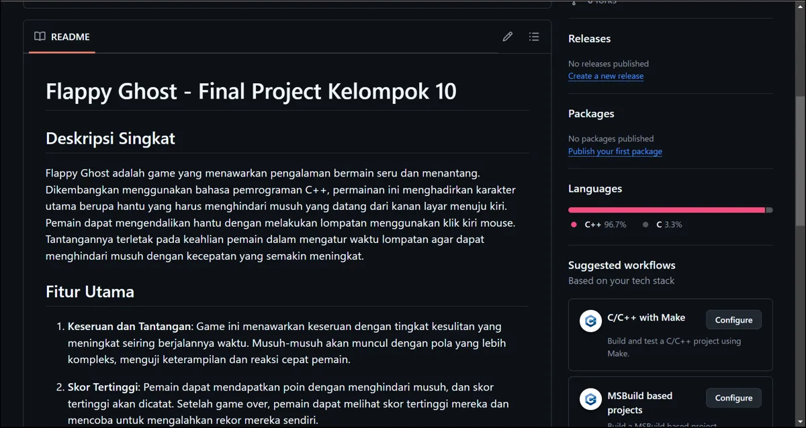

# HunterAttack: Agentic AI Breach

**Arsip studi kasus · Portofolio Lamberth Paulinus Rumpaidus**

## Ringkasan

Simulasi aksi bertema keamanan siber dengan partikel dinamis, eskalasi ancaman, dan suara sintetis.

## Tantangan

Membuat topik ancaman digital lebih menarik melalui pengalaman yang interaktif dan tidak berat dijalankan.

## Pendekatan

Merancang mekanik pergerakan, pola musuh, animasi partikel, dan umpan balik suara menggunakan Canvas serta Web Audio.

## Hasil

Pengalaman game berbasis browser yang menggabungkan mekanik survival dan tema pertahanan digital.

## Refleksi pengembangan

Simulasi game adalah media edukasi visual, bukan pengganti pengujian keamanan sistem yang sebenarnya.

## Teknologi

- Canvas 2D
- JavaScript
- Particle Systems
- Web Audio

## Status publikasi

Halaman ini merupakan arsip dokumentasi berdasarkan katalog portofolio dan aset visual yang tersedia. Kode sumber asli proyek belum tersedia dalam repositori publik yang terverifikasi. Arsip ini tidak menyatakan bahwa aplikasi dapat dijalankan dari repositori tersebut.

[Portofolio](https://lamberthrumpaidusprofile.netlify.app/) · [Dokumentasi proyek](https://lamberthrumpaidusprofile.netlify.app/documentation.html?project=hunter)
