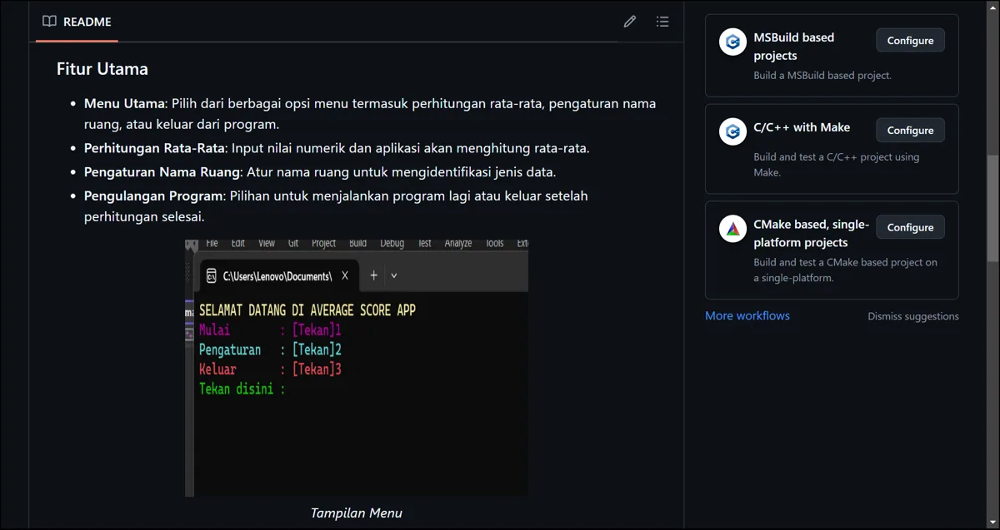

# Scraper Nexus Terminal

**Arsip studi kasus · Portofolio Lamberth Paulinus Rumpaidus**

## Ringkasan

Antarmuka monitoring ekstraksi data dengan streaming status proses dan rencana ekspor spreadsheet.

## Tantangan

Pekerjaan ekstraksi data bisa sulit diawasi apabila prosesnya berjalan tanpa status yang terlihat.

## Pendekatan

Menyusun antarmuka terminal proses, arsitektur Node/Express, SSE untuk log progres, dan format ekspor tabel.

## Hasil

Konsep alat pemantau pengumpulan data berbasis web dengan keluaran yang dapat dianalisis lebih lanjut.

## Refleksi pengembangan

Pengumpulan data web perlu mematuhi ketentuan situs, privasi, dan batas akses sumber.

## Teknologi

- Node.js
- Express
- SSE
- Cheerio
- Puppeteer

## Status publikasi

Halaman ini merupakan arsip dokumentasi berdasarkan katalog portofolio dan aset visual yang tersedia. Kode sumber asli proyek belum tersedia dalam repositori publik yang terverifikasi. Arsip ini tidak menyatakan bahwa aplikasi dapat dijalankan dari repositori tersebut.

[Portofolio](https://lamberthrumpaidusprofile.netlify.app/) · [Dokumentasi proyek](https://lamberthrumpaidusprofile.netlify.app/documentation.html?project=scraper)
