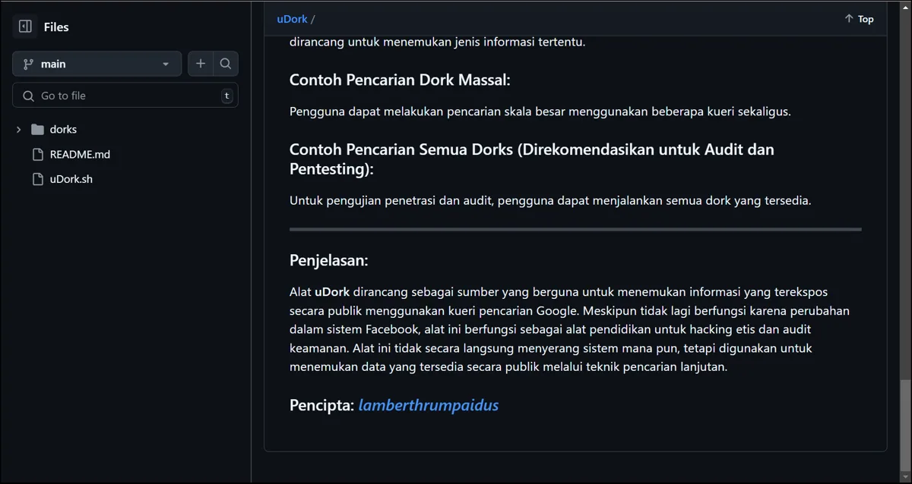

# SkripsiAja Research Portal

**Arsip studi kasus · Portofolio Lamberth Paulinus Rumpaidus**

## Ringkasan

Konsep portal riset akademik dengan penelusuran literatur dan dukungan penulisan sitasi.

## Tantangan

Pengelolaan referensi secara manual membuat mahasiswa lebih mudah salah menulis format sitasi.

## Pendekatan

Menyusun alur pencarian sumber dan format sitasi APA, MLA, IEEE, serta Harvard ke dalam portal yang lebih intuitif.

## Hasil

Prototipe antarmuka pencarian dan pembentukan format rujukan untuk membantu pekerjaan akademik.

## Refleksi pengembangan

Konsistensi format dan pemeriksaan metadata sumber tetap penting sebelum sitasi digunakan dalam karya ilmiah.

## Teknologi

- Academic Search
- Citation Formats
- UI Design
- JavaScript

## Status publikasi

Halaman ini merupakan arsip dokumentasi berdasarkan katalog portofolio dan aset visual yang tersedia. Kode sumber asli proyek belum tersedia dalam repositori publik yang terverifikasi. Arsip ini tidak menyatakan bahwa aplikasi dapat dijalankan dari repositori tersebut.

[Portofolio](https://lamberthrumpaidusprofile.netlify.app/) · [Dokumentasi proyek](https://lamberthrumpaidusprofile.netlify.app/documentation.html?project=skripsi)
