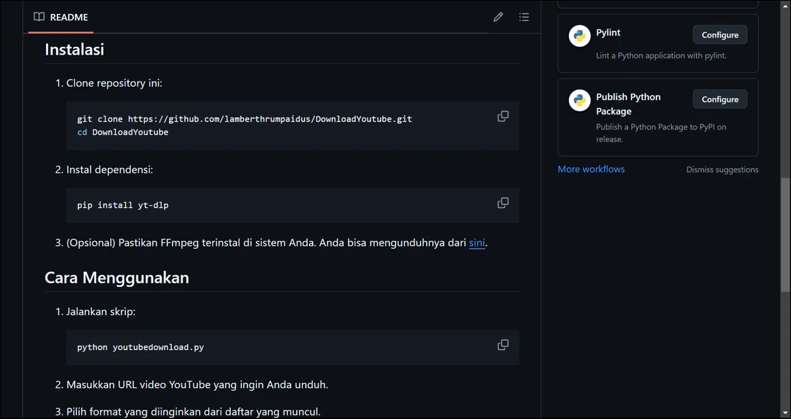

# Soopee E-Commerce Platform

**Arsip studi kasus · Portofolio Lamberth Paulinus Rumpaidus**

## Ringkasan

Konsep e-commerce dengan katalog, keranjang, penawaran, kalkulasi diskon, dan alur checkout.

## Tantangan

Perubahan stok, diskon, dan keranjang perlu tampil konsisten sepanjang perjalanan belanja pengguna.

## Pendekatan

Menyusun logika state keranjang, perhitungan biaya, penawaran flash sale, dan tampilan ringkasan pembayaran.

## Hasil

Rangkaian antarmuka belanja dari penelusuran produk hingga ringkasan pesanan dengan pembayaran berbentuk simulasi.

## Refleksi pengembangan

Konsistensi data dan kejelasan informasi pembayaran adalah kunci pengalaman pengguna dalam aplikasi transaksi.

## Teknologi

- JavaScript
- State Management
- Vite
- E-Commerce UI

## Status publikasi

Halaman ini merupakan arsip dokumentasi berdasarkan katalog portofolio dan aset visual yang tersedia. Kode sumber asli proyek belum tersedia dalam repositori publik yang terverifikasi. Arsip ini tidak menyatakan bahwa aplikasi dapat dijalankan dari repositori tersebut.

[Portofolio](https://lamberthrumpaidusprofile.netlify.app/) · [Dokumentasi proyek](https://lamberthrumpaidusprofile.netlify.app/documentation.html?project=soopee)
